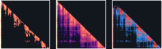

---
hide:
  - toc
---
<!-- Generated by docs/gen_heatmaps.py. Do not edit; change the generator. -->

# Attention maps

$$y(q) = \int v\,\mathrm{d}\pi_q$$

Every method in the bank satisfies invariant **W**, `y == weights @ (v_hat or v)`, so
every one of them can hand you the measure $\hat\pi_q$ it realises over context
positions. The taxonomy says each category changes exactly one object in that integral.
An $n\times n$ image of `weights` is a picture of the object the taxonomy is about, and
the signed difference against dense softmax is the **distributional term of the error
decomposition**, drawn position by position: it shows where the mass went instead.

The numbers on this page are **real activations**: layer 5, head 3 of **gpt2** (`gpt2`) reading one 80-token passage of `wikitext-103-raw-v1`. `attnbank.data` takes `(Q, K, V)` at exactly the point the model computes attention and asserts at capture time that `softmax(QKᵀ/√d + causal mask) V` reproduces the model's own attention output, so the dense map below is the one this head actually used.

<figure class="ab-hm-static">
  
  
  <figcaption>
    <b>`topk`, <code>k = 8</code></b> against dense softmax, on the head
    named above. Left, the measure <i>&#960;&#770;q</i> the method realises;
    centre, dense softmax <i>&#960;q</i>; right, the signed difference
    <i>&#960;&#770; &#8722; &#960;</i>, blue where mass was removed and red where it was
    added. Rows are queries, columns are keys, and the upper triangle is empty because
    the head is causal. Mean total variation
    <b>0.141</b>; relative output error <b>0.159</b>;
    largest single-cell difference <b>0.881</b>.
  </figcaption>
</figure>

  

    

      <button type="button" class="ab-hm-cat" data-cat="exact" data-value="exact" aria-pressed="false">exact</button><button type="button" class="ab-hm-cat" data-cat="interaction" data-value="interaction" aria-pressed="false">interaction</button><button type="button" class="ab-hm-cat" data-cat="restrict" data-value="restrict" aria-pressed="false">restrict</button><button type="button" class="ab-hm-cat" data-cat="compress" data-value="compress" aria-pressed="false">compress</button><button type="button" class="ab-hm-cat" data-cat="factorize" data-value="factorize" aria-pressed="false">factorize</button><button type="button" class="ab-hm-cat" data-cat="coupling" data-value="coupling" aria-pressed="false">coupling</button><button type="button" class="ab-hm-cat" data-cat="recurrent" data-value="recurrent" aria-pressed="false">recurrent</button>
    

    

      <label for="ab-hm-method">Method</label>
      <select id="ab-hm-method"><optgroup label="exact"><option value="softmax">softmax</option><option value="flash">flash</option><option value="lowprec">lowprec</option></optgroup><optgroup label="interaction"><option value="performer">performer</option><option value="based">based</option><option value="linear_elu">linear_elu</option><option value="cosformer">cosformer</option></optgroup><optgroup label="restrict"><option value="window">window</option><option value="topk" selected>topk</option><option value="sink_window">sink_window</option><option value="strided">strided</option><option value="blocktopk">blocktopk</option><option value="bigbird">bigbird</option><option value="reformer">reformer</option><option value="lsh_sample">lsh_sample</option></optgroup><optgroup label="compress"><option value="quantkv">quantkv</option><option value="kivi">kivi</option><option value="qjl">qjl</option><option value="evict_h2o">evict_h2o</option><option value="evict_tova">evict_tova</option><option value="mla">mla</option><option value="merge_kv">merge_kv</option></optgroup><optgroup label="factorize"><option value="abc">abc</option><option value="latte">latte</option><option value="clustered">clustered</option><option value="nmf_oracle">nmf_oracle</option></optgroup><optgroup label="coupling"><option value="sinkhorn">sinkhorn</option><option value="unbalanced_sinkhorn">unbalanced_sinkhorn</option><option value="dustbin_sinkhorn">dustbin_sinkhorn</option></optgroup><optgroup label="recurrent"><option value="decay_rnn">decay_rnn</option><option value="linear_rnn">linear_rnn</option><option value="mega">mega</option></optgroup></select>
      

    

    

      <label for="ab-hm-config" id="ab-hm-knoblabel">Configuration</label>
      <input type="range" id="ab-hm-config" min="0" max="0" step="1" value="0">
      <output for="ab-hm-config" id="ab-hm-value"></output>
    

  

  

  

  <table class="ab-hm-stats" id="ab-hm-stats"></table>

## How to read it

**Rows are queries, columns are keys.** Row $i$ is the measure $\hat\pi_{q_i}$ that
query $i$ puts over the 80 context positions; it sums to one. Under a causal mask the
upper triangle is empty, so every map is a lower triangle.

**The sequential scale is logarithmic over four decades**, shared by every map on the
page, so two methods are directly comparable and a cell that is bright here is bright
there. Attention is heavy-tailed: on this head the largest weight is
1.00 and the median weight that is not structurally zero is
1.8e-03, 3 orders of magnitude below it, so a
linear 8-bit scale would flatten the entire tail to one shade. The ramp is magma: perceptually uniform, monotonic in lightness, and
deliberately *not* one of the seven category hues, which are a nominal set for telling
categories apart and carry no order.

**The difference scale is diverging with a true zero.** Zero is the page ground, not a
colour, so untouched mass is invisible and only what a method changed is drawn. Blue is
mass the method removed, red is mass it added. Each arm is logarithmic over
3 decades below $\mathrm{d}_{\max}$, the largest single-cell difference
anywhere in that method's ladder, which is printed under the panel and is **shared
across the whole ladder** — otherwise every frame would renormalise against itself and
convergence would be invisible. A linear arm was tried first and could not resolve a
difference of 0.005 against a ladder whose worst cell is 0.9, which made maps look
blank that the numbers beside them said were not.

**Step the knob and some ladders arrive.** `lowprec`, `topk`, `sink_window`, `strided`, `blocktopk`, `reformer`, `quantkv`, `kivi` and `evict_tova` walk their map onto dense softmax: the difference panel fades to its zero colour and the mean total variation reaches zero at the right-hand end, because the last rung of each of those ladders *is* the dense operator — all of the support, every bucket, full precision. That is the convergence anchor, drawn.

**Two ladders run the other way.** `sinkhorn` and `unbalanced_sinkhorn` *start* at dense softmax — the first rung is each method's declared `limit_config`, zero Sinkhorn iterations and no column penalty — and walk away from it as the knob turns. These are `coupling` methods with objective `modify`: they do not approximate softmax, they replace its normaliser, and the difference map is a picture of what balancing the columns does to the measure rather than of an error.

**Some get closer without arriving.** `window`, `bigbird`, `lsh_sample`, `evict_h2o`, `merge_kv` and `nmf_oracle` more than halve their total variation across the ladder but do not reach zero within the range this page can draw.

**And some do not move at all.** `performer` and `based` end the ladder no better than they started — `based` goes from 0.85 to 0.88 total variation. For the random-feature and polynomial methods among them that is not a bug and not a bad ladder: the largest logit on this head is 8.1, the variance of the estimator grows with it, and the largest rung drawn here is nowhere near enough to resolve `exp` at that scale. A page that showed these converging would be showing you something that did not happen.

**And one category never had anywhere to go.** `softmax` and `flash` are in the `exact` category: they change the order of the arithmetic and nothing else. Across every configuration drawn here the largest difference from dense softmax anywhere in the matrix is 3.3e-16 — the floating-point floor — so their difference panel is blank by construction rather than by rounding. Painting that noise on a scale normalised to its own maximum would make the panel look like a large error, which is the one thing a difference map must never do.

**Hover or arrow through a row** to see that query's profile: $\hat\pi$ against $\pi$
over all 80 key positions, on the same logarithmic scale, with the row's total
variation. The strip beside the difference map is the per-row total variation down the
whole context, so you can see which queries a method hurts.

## What is not here

`nystrom`, `polysketch`, `skyformer`, `trigrff`, `linformer`, `svd_oracle`, `delta_rnn`, `gla`, `hgrn2`, `mlstm`, `retnet` and `rwkv` are in the bank and are not drawn here. Each realises weights that are not a measure over context positions — `delta_rnn` has negative entries (min -1.37) — so a sequential scale that reads as probability mass cannot honestly be put behind them, and a signed measure needs a different picture than this page draws. That is not a defect: every one of the 12 declares `row_stochastic = false` in the registry, and a method with objective `modify` is under no obligation to produce a distribution. The generator runs the check on every matrix and will not draw one that fails it.

Nothing on this page is smoothed, interpolated or illustrative. Every cell is a number
`attnbank` computed from the activations named above, quantised to eight bits and
colour-mapped in your browser. 32 methods and 141 configurations are
drawn, in 598&nbsp;kB of images and manifest all told; the page loads one
method's maps at a time.
